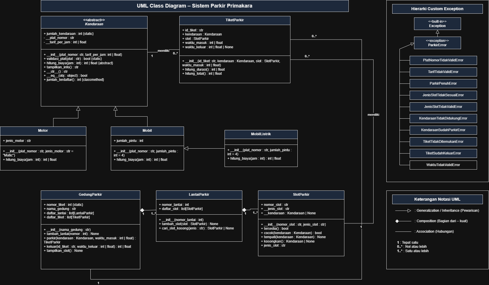

# GedungParkirPrimakara
## 1. Identitas Kelompok

 [Kelompok Photography]

Sistem Manajemen Gedung Parkir Primakara

Anggota Kelompok:

| No. | Nama Anggota | NIM |
|---|---|---|
| 1 | [Ida Ayu Rai Sukraeni] | [2501020071] |
| 2 | [Rita Anisa Ulirrohma] | [2501020059] |
| 3 | [Made Diandra Maharani] | [2501020083] |
| 4 | [Sydney Metaliana Dos Santos Narciso] | [2501020087] |

## 2. Deskripsi Sistem
Sistem Manajemen Gedung Parkir Primakara adalah website berbasis Object-Oriented yang mengelola operasional gedung parkir bertingkat secara terstruktur.

Sistem ini mencakup pengelolaan hierarki jenis kendaraan beserta tarif per jamnya (Motor Rp2.000/jam, Mobil Rp5.000/jam, dan MobilListrik Rp7.000/jam), manajemen lantai (LantaiParkir) dan kapasitas slot (SlotParkir), pencatatan tiket masuk dan keluar (TiketParkir), serta perhitungan biaya parkir dengan durasi minimal 1 jam melalui method hitung_durasi() dan hitung_total(). Seluruh aturan bisnis dan validasi input ditegakkan melalui hierarki custom exception (ParkirError) yang menyimpan detail konteks kesalahan pada atribut context.

## 3. Tabel Aturan Bisnis
| Aturan Bisnis | Class/Method yang Menegakkan | Exception yang Dimunculkan |
| :--- | :--- | :--- |
| Plat nomor kendaraan wajib bertipe str dan memiliki panjang minimal 3 karakter setelah melalui validasi_plat(). | Kendaraan.plat_nomor (setter) & Kendaraan.validasi_plat() | PlatNomorTidakValidError |
| Tarif parkir per jam wajib berupa angka (int/float, bukan bool) dan bernilai positif (> 0). | Kendaraan.tarif_per_jam (setter) | TarifTidakValidError |
| Jenis slot parkir yang didaftarkan hanya boleh bernilai "Motor" atau "Mobil". | SlotParkir.jenis_slot (setter) | JenisSlotTidakValidError |
| Slot parkir yang sudah terisi tidak dapat ditempati kendaraan lain, dan gedung tidak dapat menerima kendaraan jika seluruh slot untuk jenis tersebut penuh. | SlotParkir.tersedia(), SlotParkir.tempati(), LantaiParkir.cari_slot_kosong(), GedungParkir.parkir() | ParkirPenuhError |
| Kendaraan hanya dapat menempati slot parkir yang sesuai dengan jenisnya (Motor di slot "Motor", Mobil/MobilListrik di slot "Mobil"). | SlotParkir.cocok() & SlotParkir.tempati() | JenisSlotTidakSesuaiError |
| Objek yang masuk ke sistem parkir harus merupakan turunan dari abstract class Kendaraan (Motor, Mobil, atau MobilListrik). | GedungParkir.parkir() | KendaraanTidakDidukungError |
| Kendaraan dengan jenis dan plat nomor yang sama tidak dapat masuk apabila masih memiliki tiket parkir aktif (waktu_keluar is None). | Kendaraan.__eq__() & GedungParkir.parkir() | KendaraanSudahParkirError |
| Proses keluar parkir hanya dapat diproses menggunakan id_tiket yang terdaftar di daftar_tiket gedung parkir. | GedungParkir.keluar() | TiketTidakDitemukanError |
| Tiket yang sudah memiliki catatan waktu_keluar tidak dapat digunakan kembali untuk proses keluar. | GedungParkir.keluar() | TiketSudahKeluarError |
| Waktu masuk tidak boleh negatif (< 0) dan waktu keluar tidak boleh lebih kecil dari waktu masuk (waktu_keluar < waktu_masuk). | TiketParkir.__init__(), GedungParkir.parkir(), GedungParkir.keluar() | WaktuTidakValidError |
---


## 4. UML Class Diagram 



## 5. Daftar Custom Exception
Seluruh custom exception mewarisi ParkirError (turunan Exception) yang menyimpan pesan kesalahan (message) dan informasi konteks dinamis dalam atribut context (dict), lalu memformat tampilannya melalui method __str__().

| Nama Exception | Class Induk | Atribut Konteks (context) | Kapan Dimunculkan | Method yang Memunculkan | Cara Program Menanganinya |
| :--- | :--- | :--- | :--- | :--- | :--- |
| ParkirError | Exception | context (dict dinamis yang diterima lewat parameter kwargs) | Sebagai base exception untuk seluruh kesalahan pada domain sistem parkir. | Seluruh method validasi dan transaksi parkir | Ditangkap oleh fungsi jalankan_skenario() pada blok try-except ParkirError as error untuk mencetak "Gagal:" beserta detail konteks dari __str__(). |
| PlatNomorTidakValidError | ParkirError | plat_nomor | Ketika validasi_plat() mengembalikan False (bukan str atau panjang karakter setelah .strip() kurang dari 3). | Kendaraan.plat_nomor (setter) | Menggagalkan inisialisasi objek Kendaraan dan mencetak "Gagal: Plat nomor tidak valid (plat_nomor=...)". |
| TarifTidakValidError | ParkirError | tarif, plat_nomor | Ketika tarif_per_jam bukan int/float, bertipe bool, atau bernilai <= 0. | Kendaraan.tarif_per_jam (setter) | Menggagalkan perubahan/pengaturan tarif dan mencetak "Gagal: Tarif harus berupa angka positif (tarif=..., plat_nomor=...)". |
| JenisSlotTidakValidError | ParkirError | jenis_slot, nomor_slot | Ketika nilai jenis_slot bukan "Motor" maupun "Mobil". | SlotParkir.jenis_slot (setter) | Menggagalkan pembuatan objek SlotParkir dan mencetak "Gagal: Jenis slot tidak valid (jenis_slot=..., nomor_slot=...)". |
| ParkirPenuhError | ParkirError | nomor_slot (pada SlotParkir) atau plat_nomor (pada GedungParkir) | Ketika tersedia() bernilai False pada slot spesifik atau cari_slot_kosong() mengembalikan None di semua lantai. | SlotParkir.tempati(), GedungParkir.parkir() | Membatalkan proses parkir masuk, tidak membuat TiketParkir baru, dan mencetak pesan kapasitas penuh. |
| JenisSlotTidakSesuaiError | ParkirError | jenis_slot, jenis_kendaraan, plat_nomor | Ketika method cocok() mengembalikan False (misal Mobil masuk ke slot "Motor"). | SlotParkir.tempati() | Menolak pengisian slot (self.__kendaraan tetap None) dan mencetak ketidaksesuaian jenis slot dan kendaraan. |
| KendaraanTidakDidukungError | ParkirError | kendaraan | Ketika parameter kendaraan bukan instance dari Kendaraan atau bukan subclass yang didukung. | GedungParkir.parkir() | Menghentikan proses parkir sebelum pencarian slot dan mencetak nama tipe objek yang ditolak. |
| KendaraanSudahParkirError | ParkirError | plat_nomor | Ketika ditemukan tiket aktif (waktu_keluar is None) dengan objek kendaraan yang sama (tiket_aktif.kendaraan == kendaraan). | GedungParkir.parkir() | Mencegah penerbitan tiket ganda dan memberi informasi bahwa kendaraan masih memiliki tiket parkir aktif. |
| TiketTidakDitemukanError | ParkirError | id_tiket | Ketika id_tiket yang diinput saat keluar tidak cocok dengan data mana pun di daftar_tiket. | GedungParkir.keluar() | Membatalkan transaksi keluar serta pengosongan slot, lalu mencetak id_tiket yang tidak ditemukan. |
| TiketSudahKeluarError | ParkirError | id_tiket | Ketika tiket yang diproses untuk keluar sudah memiliki nilai waktu_keluar (is not None). | GedungParkir.keluar() | Menolak perhitungan biaya ulang dan memberi informasi bahwa tiket tersebut sudah digunakan untuk keluar. |
| WaktuTidakValidError | ParkirError | waktu_masuk (dan waktu_keluar saat keluar) | Ketika waktu_masuk bukan angka/negatif, atau waktu_keluar bukan angka/lebih kecil dari waktu_masuk. | TiketParkir.__init__(), GedungParkir.parkir(), GedungParkir.keluar() | Menggagalkan pembuatan tiket atau proses keluar sehingga status slot tidak dikosongkan. |

## 6. Cara Menjalankan Program
### Perintah untuk Menjalankan Program
Pastikan berada pada direktori yang memuat file main.py, gedung_parkir.py, dan exception.py (folder src/), lalu jalankan:

```bash
python src/main.py

## 7. Contoh Output Program

========================================
            SKENARIO BERHASIL
========================================

Nama gedung: Parkir Primakara

--- Proses Kendaraan Masuk ---
Motor berhasil parkir.
Mobil berhasil parkir.
Mobil listrik berhasil parkir.

--- Data Kendaraan ---
Motor: DK1234AB - Rp2000/jam
Mobil: DK5678CD - Rp5000/jam
Mobil listrik: DK9999EF - Rp7000/jam

--- Data Tiket Parkir ---
Tiket motor: 1
Tiket mobil: 2
Tiket mobil listrik: 3

--- Pengujian Kesamaan Kendaraan ---
Objek motor sama: True

========================================
             SKENARIO GAGAL
========================================

--- Plat Nomor Tidak Valid ---
Gagal: Plat nomor tidak valid (plat_nomor=)
Pengujian selesai.

--- Tarif Tidak Valid ---
Gagal: Tarif harus berupa angka positif (tarif=-1000, plat_nomor=DK1234AB)
Pengujian selesai.

--- Jenis Slot Tidak Valid ---
Gagal: Jenis slot tidak valid (jenis_slot=Bus, nomor_slot=X1)
Pengujian selesai.

--- Kendaraan Tidak Didukung ---
Gagal: Objek yang dimasukkan bukan kendaraan yang didukung (kendaraan=str)
Pengujian selesai.

--- Kendaraan Sudah Parkir ---
Gagal: Kendaraan masih memiliki tiket parkir aktif (plat_nomor=DK1234AB)
Pengujian selesai.

--- Jenis Slot Tidak Sesuai ---
Gagal: Jenis kendaraan tidak sesuai dengan slot (jenis_slot=Motor, jenis_kendaraan=Mobil, plat_nomor=DK3333AA)
Pengujian selesai.

--- Waktu Tidak Valid ---
Gagal: Waktu masuk tidak valid (waktu_masuk=-5)
Pengujian selesai.

--- Parkir Penuh ---
Gagal: Tidak ada slot parkir yang tersedia (plat_nomor=DK1113AA)
Pengujian selesai.

--- Tiket Tidak Ditemukan ---
Gagal: Tiket parkir tidak ditemukan (id_tiket=999)
Pengujian selesai.

========================================
         PROSES KENDARAAN KELUAR
========================================
Biaya motor: Rp 4000
Biaya mobil: Rp 15000
Biaya mobil listrik: Rp 28000

--- Tiket Sudah Keluar ---
Gagal: Tiket parkir sudah digunakan untuk keluar (id_tiket=1)
Pengujian selesai.


## 8. Pembagian Peran

| No. | Nama Anggota | Tanggung Jawab |
|---|---|---|
| 1 | [Ida Ayu Rai Sukraeni] | [Mengembangkan main.py dan integrasi program] |
| 2 | [Made Diandra Maharani] | [Membuat custom exception] |
| 3 | [Rita Anisa Ulirrohma] | [Membuat dan memperbarui UML] |
| 4 | [Sydney Metaliana Dos Santos] | [Dokumentasi REALME] |

---

**Repository:** [URL GitHub Kelompok]
